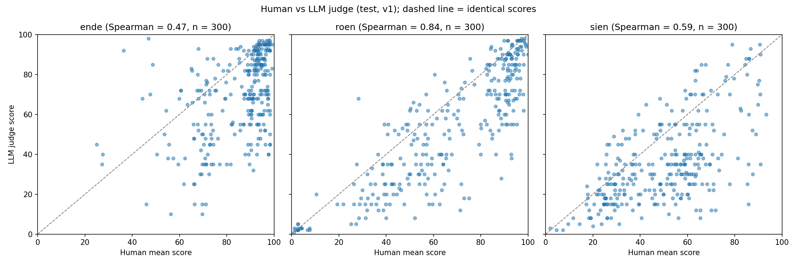

# Annotation Quality in Multilingual AI Data

How consistent are human quality scores for machine translations, and what drives disagreement between annotators?

**Status:** stage 1 (human agreement analysis) and stage 2 (comparing an LLM judge with the human scores) are complete. Stage 3 is planned, see the [Roadmap](#roadmap).

## Goal

Companies that train AI rely on human-labelled data, so it matters whether that data can be trusted and whether different people give similar labels. This project measures how consistently annotators rate the same machine translations, using a real public dataset.

## Data

The project uses [MLQE-PE](https://github.com/sheffieldnlp/mlqe-pe), a public dataset released under the CC0 licence (Fomicheva et al., 2020). Each sample is:

- a sentence translated by a neural machine translation model,
- a quality score from 0 to 100 given by professional translators,
- one of 7 language pairs (for example en-de, ro-en),
- 3 or 6 independent scores per sentence.

The data is divided into three splits: train, dev and test. The sentence-level files used here are the direct-assessment files (`*.df.short.tsv`).

## Method

Agreement between annotators was measured with the intraclass correlation coefficient (ICC(1,1)), computed separately for each language pair using only sentences with exactly 3 (train) or exactly 6 (dev and test) scores. The two groups were analysed separately because their scores were collected under different procedures. 95% confidence intervals were estimated by bootstrapping (1,000 resamples of sentences, with replacement). Additionally, we compared how much sentence quality varies within each language pair, using the standard deviation of the sentence mean scores.

ICC measures how much of the variation in scores comes from real differences between sentences rather than disagreement between annotators. It ranges from 0 (scores are mostly noise) to 1 (annotators agree); values slightly below 0 mean there is no usable signal.

## Results

Train data (3 scores per sentence), from `reports/icc_train_all_pairs.csv`:

| Pair | Sentences | ICC | 95% CI | Mean score | Std of sentence means |
|---|---|---|---|---|---|
| en-de | 6407 | 0.424 | 0.386 - 0.458 | 86.4 | 10.8 |
| en-zh | 6551 | 0.824 | 0.817 - 0.832 | 68.6 | 19.0 |
| et-en | 7000 | 0.884 | 0.881 - 0.888 | 67.0 | 26.9 |
| ne-en | 7000 | 0.819 | 0.812 - 0.824 | 38.3 | 20.2 |
| ro-en | 7000 | 0.907 | 0.903 - 0.910 | 68.9 | 27.6 |
| ru-en | 7000 | 0.891 | 0.887 - 0.894 | 68.2 | 25.8 |
| si-en | 7000 | 0.914 | 0.911 - 0.916 | 50.3 | 29.9 |

Dev and test data (6 scores per sentence, 1000 sentences each; ru-en is not included because it has only 3 scores per sentence in these splits):

| Pair | ICC dev | ICC test |
|---|---|---|
| en-de | 0.373 | 0.377 |
| en-zh | 0.312 | 0.245 |
| et-en | 0.630 | 0.605 |
| ne-en | 0.588 | 0.587 |
| ro-en | 0.806 | 0.778 |
| si-en | 0.553 | 0.450 |


## Findings

1. In the train data (3 scores per sentence), agreement is high for six of the seven language pairs (ICC above 0.80), except for en-de, where the ICC is only 0.42 (95% CI 0.39-0.46).
2. The low agreement in en-de is mainly explained by the narrow range of sentence quality: most translations are rated similarly high (the middle half of the sentence means lies between 83 and 92), so there is little variation between sentences. In addition, annotators disagree slightly more within a sentence than in ro-en.
3. In the dev and test data (6 scores per sentence), the ICC is lower for every language pair, from 0.25 (en-zh) to 0.81 (ro-en). Ro-en stays the most consistent pair in both settings.
4. The spread of sentence quality is related to the ICC (en-zh and en-de have the smallest spread and the lowest ICC), but it does not explain everything: et-en has the largest spread and still only reaches an ICC of about 0.6.
5. A high ICC means consistent scoring, not good translations: all annotators can agree that a translation is bad.

## Limitations

- Annotator IDs are not available, so the analysis is at sentence level and cannot identify individual unreliable annotators.
- In the train data, scores that differed by more than 30 points were re-collected, which probably inflates the agreement. The lower ICC in dev and test is consistent with this, but different sentences with a different quality spread could also contribute, and the two effects were not separated here.
- The 6 scores in dev and test come from two groups of annotators from different providers; ICC(1,1) treats all six as interchangeable, so systematic differences between the groups lower the ICC.
- Dev and test give noticeably different results for some pairs (for example si-en: 0.55 vs 0.45), which the bootstrap intervals (sampling of sentences only) do not capture.

## Stage 2: how well does an LLM judge agree with humans?

Stage 1 showed that humans agree with each other only up to a point. Stage 2 asks: if we let an AI model score the same translations, does it agree with humans about as well as humans agree with each other?

### Setup

- **Judge:** Claude (Sonnet), run through the Claude Code command line, with one fixed prompt. It sees the source sentence and the translation and gives a score from 0 to 100, in batches of 20 sentences from one language pair.
- **Language pairs:** en-de, ro-en and si-en, chosen because they have 6 human scores per sentence and very different human agreement (stage 1).
- **Samples:** 100 sentences per pair from dev (used to build and check the pipeline) and 300 sentences per pair from test (the final result; nothing was tuned on it). Sampling used a fixed random seed (42).
- **Human reference:** the mean of the 6 human scores. The 6 scores come from two independent groups of 3 annotators (checked in script 07), so each sentence also has a "group A mean" and a "group B mean".
- **Agreement measure:** Spearman correlation (do the judge and the humans put sentences in the same order?), with a 95% bootstrap confidence interval over sentences. Correlation ignores a constant shift, so the judge being harsher does not affect it.
- **Human ceiling:** the correlation between the group A mean and the group B mean. It tells how well two independent groups of humans agree and serves as a reference line for the judge.

### Results (test, 300 sentences per pair)

| Pair | Spearman, judge vs human mean | 95% CI | Judge vs group A | Judge vs group B | Group A vs group B (ceiling) | Judge minus human (points) |
|---|---|---|---|---|---|---|
| ro-en | **0.84** | 0.80 - 0.87 | 0.84 | 0.79 | 0.83 | -12.9 |
| si-en | 0.59 | 0.49 - 0.67 | 0.37 | 0.55 | 0.18 | -14.2 |
| en-de | 0.47 | 0.36 - 0.56 | 0.52 | 0.16 | 0.25 | -15.2 |

(The three columns comparing the judge and the human groups, and the ceiling, use Pearson correlation.)

On the dev sample (100 sentences) the judge looked better in the two harder pairs (en-de 0.66, si-en 0.72), but with 100 sentences the confidence intervals are wide. The test result is the one to trust.



### Findings

1. **The judge agrees with humans about as well as humans agree with each other.** In ro-en it reaches the level of a second group of annotators (0.84 against a ceiling of 0.83). The ro-en result is clearly better than en-de and si-en (the confidence intervals do not overlap); the difference between en-de and si-en is not clear.
2. **The ranking of language pairs is the same as in stage 1:** where humans agree most (ro-en), the judge agrees most too. The quality of the human labels limits what any judge can be measured against.
3. **The judge is stricter than humans by about 13-15 points in every pair.** This does not change the correlations, but it means the judge's scores should not be used as absolute numbers without calibration.
4. **En-de is hard to measure, mostly because of the human scores.** Nearly all en-de translations get a very high human score (see the scatter plot), so there is almost no variation for the judge to be compared with. Group B also scores more generously and with a smaller spread than group A (mean 88.4 and std 13.4, against 80.9 and 21.7), which fits its low agreement with both group A and the judge. We do not know why group B behaves this way.
5. **Some large disagreements are real translation errors that humans missed.** In en-de, humans gave about 98 to *enshrined them in the shrine* translated as *verhaftete sie im Schrein* ("arrested them") and to *breastworks* translated as *Brüste* ("breasts"), while the judge gave 40-50. In ro-en, garbled translations such as *"the theatre invades Peloponad"* got 71 from humans and 12 from the judge. These are hand-picked extreme cases, so they show that the judge can be right where humans are wrong, not how often.
6. **Some disagreements come from rules the prompt did not specify:** whether leaving a name or title untranslated is a mistake (the judge scored it 92-98, humans 36-47) and how to score a translation of a source sentence that is itself cut off (humans 93, judge 38). These are differences in the definition of "quality", not errors of the judge.
7. **A small sample can mislead:** en-de dropped from 0.66 (dev, 100 sentences) to 0.47 (test, 300 sentences).

The full lists of the biggest disagreements are generated by `scripts/13_error_analysis.py` and `scripts/14_error_report_md.py` (see `reports/error_report_test_v1.md`).

### Limitations of stage 2

- One judge model, one prompt and one run. We did not measure how much the judge's scores change when the same sentences are scored again or when the prompt is reworded.
- Only 3 of the 6 language pairs with 6 scores were used, and the human ceiling is a rough benchmark, not a hard limit. A judge compared with one group of 3 annotators has a small advantage over two groups compared with each other, because noise in the human scores affects only one side of the comparison. In si-en the ceiling is also unstable (0.53 on dev, 0.18 on test).
- The error examples are extreme cases chosen for illustration. Who is right in each case was judged by the author, not by independent translators.
- The judge sees the source sentence and the translation without any scoring guidelines for names, titles or incomplete sources.

## Project structure

```
Project/
  README.md
  requirements.txt
  data/                   raw data, not edited, not tracked in git
    ro-en-train/ ...      one folder per language pair (train)
    dev_test/ ...         dev and test files
    judge/                samples and judge scores (stage 2), generated by the scripts
  scripts/                analysis scripts, run in numeric order
  reports/                results (CSV) and figures
```

### Scripts

| Script | What it does |
|---|---|
| `01_score_spread_ro_en.py` | Score spread (max - min) per sentence for ro-en train |
| `02_between_vs_within_sentences.py` | Differences between sentences vs inside sentences, and the distribution of sentence mean scores (one pair) |
| `03_icc_bootstrap_single_pair.py` | ICC with a bootstrap confidence interval for one pair (train, 3 scores) |
| `04_icc_dev_test_six_raters.py` | ICC with confidence intervals for dev and test (6 scores) |
| `05_icc_train_all_pairs.py` | ICC with confidence intervals for all pairs (train), saves `reports/icc_train_all_pairs.csv` |
| `06_plot_icc_by_language_pair.py` | Creates `reports/icc_by_language_pair.png` from the CSV |
| `07_check_rater_groups.py` | Checks that the 6 scores come from two independent groups of 3 (positions 1-3 and 4-6) |
| `08_make_judge_sample.py` | Draws the random samples for the judge and saves the human reference scores |
| `09_judge_pilot.py` | Small test of the judge on 20 sentences |
| `10_pilot_vs_human.py` | Compares the pilot scores with the human scores |
| `11_judge_run.py` | Scores a whole sample with the judge, can be resumed after an interruption. Usage: `python scripts/11_judge_run.py test v1` |
| `12_evaluate_judge.py` | Correlation of judge vs humans per pair, with confidence intervals and the human ceiling. Usage: `python scripts/12_evaluate_judge.py test v1` |
| `13_error_analysis.py` | Lists the biggest disagreements between judge and humans and compares the spread of the two human groups |
| `14_error_report_md.py` | Writes the disagreements as a readable Markdown report |
| `15_plot_scatter.py` | Scatter plot of human vs judge scores |

Scripts 01-04 contain absolute Windows paths (`C:\Project\...`); change them if your folder is elsewhere. Scripts 05-15 use paths relative to the project folder, so run them from the project folder.

## How to reproduce

1. Install Python 3.10 or newer and the requirements: `pip install -r requirements.txt`
2. Download the data from the `data/direct-assessments` folder of the [MLQE-PE repository](https://github.com/sheffieldnlp/mlqe-pe) (archives `<pair>-train.tar.gz`, `<pair>-dev.tar.gz`, `<pair>-test.tar.gz`), extract them into `data/` (train) and `data/dev_test/` (dev and test) so that the layout matches the structure above.
3. Run the scripts, for example: `python scripts/05_icc_train_all_pairs.py` and then `python scripts/06_plot_icc_by_language_pair.py`.
4. Stage 2 needs [Claude Code](https://claude.com/claude-code) installed and logged in, because the judge is called through its command line (`claude -p`). Run scripts 08, then 11 and 12 (`python scripts/11_judge_run.py test v1`, `python scripts/12_evaluate_judge.py test v1`), then 13 and 15. Scoring 900 sentences uses a noticeable part of a subscription limit. The judge script stops if `ANTHROPIC_API_KEY` is set, so it never bills the API by accident. Install `scipy` as well (`pip install scipy`).

## Roadmap

- Stage 2 (done): score a sample of translations with an LLM judge and compare with the human scores, see above.
- Possible extension of stage 2: repeat the judge run and reword the prompt to measure how stable the scores are, add rules for names and incomplete sources to the prompt, and calibrate the judge's scores to the human scale.
- Stage 3: estimate how many annotators per sentence are needed for a given reliability (cost vs quality), and summarise recommendations.

## Citation

Fomicheva, M. et al. (2020). MLQE-PE: A Multilingual Quality Estimation and Post-Editing Dataset. arXiv:2010.04480.
