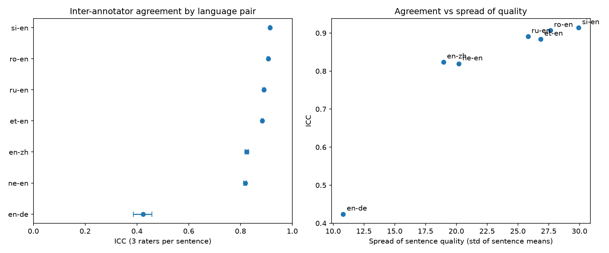

# Annotation Quality in Multilingual AI Data

How consistent are human quality scores for machine translations, and what drives disagreement between annotators?

**Status:** stage 1 (human agreement analysis) is complete. Stage 2 (comparing human scores with an LLM judge) is planned, see the [Roadmap](#roadmap).

## Goal

Companies that train AI rely on human-labelled data, so it matters whether that data can be trusted and whether different people give similar labels. This project measures how consistently annotators rate the same machine translations, using a real public dataset.

## Data

The project uses [MLQE-PE](https://github.com/sheffieldnlp/mlqe-pe), a public dataset released under the CC0 licence (Fomicheva et al., 2020). Each sample is:

- a sentence translated by a neural machine translation model,
- a quality score from 0 to 100 given by professional translators,
- one of 7 language pairs (for example en-de, ro-en),
- 3 or 6 independent scores per sentence.

The data is divided into three splits: train, dev and test. The sentence-level files used here are the direct-assessment files (`*.df.short.tsv`).

## Method

Agreement between annotators was measured with the intraclass correlation coefficient (ICC(1,1)), computed separately for each language pair using only sentences with exactly 3 (train) or exactly 6 (dev and test) scores. The two groups were analysed separately because their scores were collected under different procedures. 95% confidence intervals were estimated by bootstrapping (1,000 resamples of sentences, with replacement). Additionally, we compared how much sentence quality varies within each language pair, using the standard deviation of the sentence mean scores.

ICC measures how much of the variation in scores comes from real differences between sentences rather than disagreement between annotators. It ranges from 0 (scores are mostly noise) to 1 (annotators agree); values slightly below 0 mean there is no usable signal.

## Results

Train data (3 scores per sentence), from `reports/icc_train_all_pairs.csv`:

| Pair | Sentences | ICC | 95% CI | Mean score | Std of sentence means |
|---|---|---|---|---|---|
| en-de | 6407 | 0.424 | 0.386 - 0.458 | 86.4 | 10.8 |
| en-zh | 6551 | 0.824 | 0.817 - 0.832 | 68.6 | 19.0 |
| et-en | 7000 | 0.884 | 0.881 - 0.888 | 67.0 | 26.9 |
| ne-en | 7000 | 0.819 | 0.812 - 0.824 | 38.3 | 20.2 |
| ro-en | 7000 | 0.907 | 0.903 - 0.910 | 68.9 | 27.6 |
| ru-en | 7000 | 0.891 | 0.887 - 0.894 | 68.2 | 25.8 |
| si-en | 7000 | 0.914 | 0.911 - 0.916 | 50.3 | 29.9 |

Dev and test data (6 scores per sentence, 1000 sentences each; ru-en is not included because it has only 3 scores per sentence in these splits):

| Pair | ICC dev | ICC test |
|---|---|---|
| en-de | 0.373 | 0.377 |
| en-zh | 0.312 | 0.245 |
| et-en | 0.630 | 0.605 |
| ne-en | 0.588 | 0.587 |
| ro-en | 0.806 | 0.778 |
| si-en | 0.553 | 0.450 |



## Findings

1. In the train data (3 scores per sentence), agreement is high for six of the seven language pairs (ICC above 0.80), except for en-de, where the ICC is only 0.42 (95% CI 0.39-0.46).
2. The low agreement in en-de is mainly explained by the narrow range of sentence quality: most translations are rated similarly high (the middle half of the sentence means lies between 83 and 92), so there is little variation between sentences. In addition, annotators disagree slightly more within a sentence than in ro-en.
3. In the dev and test data (6 scores per sentence), the ICC is lower for every language pair, from 0.25 (en-zh) to 0.81 (ro-en). Ro-en stays the most consistent pair in both settings.
4. The spread of sentence quality is related to the ICC (en-zh and en-de have the smallest spread and the lowest ICC), but it does not explain everything: et-en has the largest spread and still only reaches an ICC of about 0.6.
5. A high ICC means consistent scoring, not good translations: all annotators can agree that a translation is bad.

## Limitations

- Annotator IDs are not available, so the analysis is at sentence level and cannot identify individual unreliable annotators.
- In the train data, scores that differed by more than 30 points were re-collected, which probably inflates the agreement. The lower ICC in dev and test is consistent with this, but different sentences with a different quality spread could also contribute, and the two effects were not separated here.
- The 6 scores in dev and test come from two groups of annotators from different providers; ICC(1,1) treats all six as interchangeable, so systematic differences between the groups lower the ICC.
- Dev and test give noticeably different results for some pairs (for example si-en: 0.55 vs 0.45), which the bootstrap intervals (sampling of sentences only) do not capture.

## Project structure

```
Project/
  README.md
  requirements.txt
  data/                   raw data, not edited, not tracked in git
    ro-en-train/ ...      one folder per language pair (train)
    dev_test/ ...         dev and test files
  scripts/                analysis scripts, run in numeric order
  reports/                results (CSV) and figures
```

### Scripts

| Script | What it does |
|---|---|
| `01_score_spread_ro_en.py` | Score spread (max - min) per sentence for ro-en train |
| `02_between_vs_within_sentences.py` | Differences between sentences vs inside sentences, and the distribution of sentence mean scores (one pair) |
| `03_icc_bootstrap_single_pair.py` | ICC with a bootstrap confidence interval for one pair (train, 3 scores) |
| `04_icc_dev_test_six_raters.py` | ICC with confidence intervals for dev and test (6 scores) |
| `05_icc_train_all_pairs.py` | ICC with confidence intervals for all pairs (train), saves `reports/icc_train_all_pairs.csv` |
| `06_plot_icc_by_language_pair.py` | Creates `reports/icc_by_language_pair.png` from the CSV |

Scripts 01-04 contain absolute Windows paths (`C:\Project\...`); change them if your folder is elsewhere. Scripts 05 and 06 use paths relative to the project folder.

## How to reproduce

1. Install Python 3.10 or newer and the requirements: `pip install -r requirements.txt`
2. Download the data from the `data/direct-assessments` folder of the [MLQE-PE repository](https://github.com/sheffieldnlp/mlqe-pe) (archives `<pair>-train.tar.gz`, `<pair>-dev.tar.gz`, `<pair>-test.tar.gz`), extract them into `data/` (train) and `data/dev_test/` (dev and test) so that the layout matches the structure above.
3. Run the scripts, for example: `python scripts/05_icc_train_all_pairs.py` and then `python scripts/06_plot_icc_by_language_pair.py`.

## Roadmap

- Stage 2: score a sample of translations with an LLM judge and compare with the human scores. Human-human agreement (ICC above) is the ceiling for how well any judge can agree with humans.
- Stage 3: estimate how many annotators per sentence are needed for a given reliability (cost vs quality), and summarise recommendations.

## Citation

Fomicheva, M. et al. (2020). MLQE-PE: A Multilingual Quality Estimation and Post-Editing Dataset. arXiv:2010.04480.
